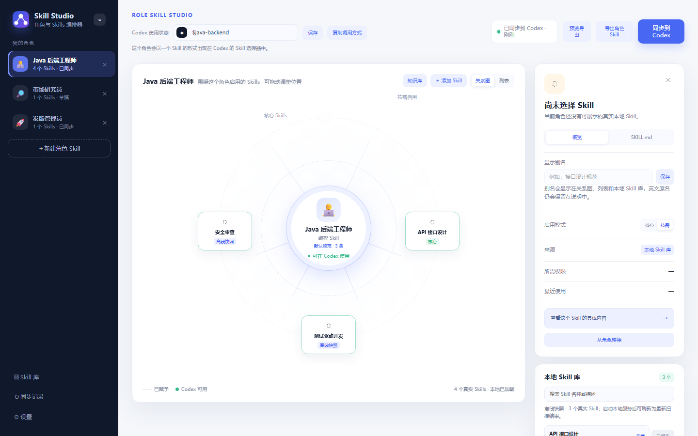

# Skill Studio

把散落在 `~/.agents/skills`、`~/.codex/skills` 里的 Codex Skill 编排成「角色 Skill」，再一键同步回 Codex 的 Skill 目录。

一句话：**先给角色配好能力，之后一句 `$角色名` 就能把整套能力调起来。**

> 本地桌面应用（Rust + WebView2 外壳 + Node 本地服务）。不联网、不上传任何数据，所有内容都只写在本机。



## 它解决什么问题

Skill 一多就会遇到三个麻烦：

1. 记不住有哪些 Skill、每个是干什么的 —— 英文目录名点进去才知道内容。
2. 每次都要在提示词里手写「先用 A，再用 B，最后用 C」，写得长还容易漏。
3. 同一个人要在多个身份之间切换（后端开发 / 竞品调研 / 发版），每次都得重复交代一遍上下文。

Skill Studio 把「一组 Skill + 使用方式 + 约束」固化成一个角色，角色本身就是一个能被 Codex 识别的 Skill。之后只需要 `$java` 这样的调用指令，Codex 就会带着这套编排去干活。

## 核心概念

| 概念 | 说明 |
| --- | --- |
| 角色 Skill | 最终同步给 Codex 的 Skill，内部负责调度若干子 Skill |
| 子 Skill | 从本机目录扫描到的真实 `SKILL.md`，不会被复制或改写 |
| 启用模式 | `核心`（优先调用）与 `按需`（匹配任务时才调用） |
| 别名 | 给英文 Skill 起中文名，列表和关系图里显示别名，原文保留 |
| 知识库 | 给角色挂一个目录或上传文件，同步时一起复制到角色目录旁边 |

## 功能

- **角色管理**：新建、切换、删除；删除时可选择同时清理已同步出去的 `SKILL.md` 目录。
- **关系图**：以角色为中心的环绕布局，节点可拖到自定义位置，位置会被记住。
- **Skill 库**：扫描本机 Skill 根目录，支持搜索、起别名、一键移除。
- **调用指令**：`$java` 这类唤起指令可直接编辑，重复时会拦下来。
- **导出与同步**：生成编排用的 `SKILL.md`，支持先预览再导出；同步会写入 Codex Skill 目录。
- **跨机器**：Skill 换台电脑后路径会变，界面按名字重新对上原有分配关系，不用重配。
- **界面**：左侧栏可收起，滚动条统一隐藏。

## 快速开始

### 1. 离线预览（零依赖）

直接用浏览器打开仓库根目录的 `index.html`。此模式加载 `offline-skills.js` 里的快照，只用于看界面，不能写入 Codex 目录。

### 2. 本地服务（开发调试用）

```bash
npm install
npm run client
# 打开 http://127.0.0.1:4173/
```

服务启动后会实时扫描本机 Skill 目录，改完界面刷新即可生效。

### 3. 打包成 Windows 桌面应用

```bash
npm install
npm run build:app
```

产物在 `SkillStudio/`：

| 路径 | 说明 |
| --- | --- |
| `SkillStudio.exe` | 应用窗口程序（Rust + WebView2），双击启动 |
| `service/SkillStudio.exe` | 本地服务（Node 单文件 exe），由窗口程序自动拉起 |
| `data/state.json` | 角色、别名、同步记录 |

行为说明：

- 打开的是应用自己的窗口，不会跳浏览器，也不会闪命令行窗口。
- 关闭窗口时后台服务一起结束，不留残留进程。
- 端口被占用时自动顺延；已有实例在跑时重复双击只会再开一个窗口。

构建依赖：Rust 工具链 + WebView2 运行时（Windows 10/11 一般自带）。

只重新生成服务端 exe 时用 `npm run build:exe`。

## 目录结构

```text
.
├── index.html                单文件界面（HTML + CSS + JS，无构建步骤）
├── offline-skills.js         离线预览用的 Skill 快照，由 npm run snapshot 生成
├── package.json
├── src/
│   ├── backend/
│   │   ├── server.js         开发模式入口
│   │   ├── studioServer.js   HTTP 服务与 API
│   │   ├── skillScanner.js   扫描并解析 SKILL.md
│   │   └── exeRuntime.js     数据目录 / 端口 / Skill 根目录解析
│   └── domain/
│       └── roleStore.js      角色操作与编排 Skill 生成
├── build/
│   ├── desktop/              Rust + WebView2 桌面外壳
│   ├── exe/                  Node SEA 单文件服务
│   └── snapshot-offline.mjs  生成 offline-skills.js
├── tests/                    node:test 测试
├── data/
│   └── state.example.json    示例数据（真实数据不会提交）
└── docs/preview.png
```

## 同步出来的 Skill 长什么样

点击「同步到 Codex」后，会在 `~/.agents/skills/<角色>/SKILL.md` 写入类似内容：

```markdown
---
name: java
description: 负责调度相关 Skills 完成用户任务。本角色编排了 10 项能力：接口设计规范、代码审查……
---

# Java 后端工程师

你是"Java 后端工程师"这一角色 Skill，负责理解用户任务、选择合适的子 Skill、组织执行顺序，并汇总出可验证的结果。

## 可调度的 Skills

- **api-design**（核心能力）：REST API 设计规范……
- **tdd-workflow**（按需调用）：测试驱动开发流程……

## 工作方式

1. 先理解任务目标、约束和当前项目上下文。
2. 根据任务选择相关的子 Skill；核心能力优先，按需能力仅在匹配时调用。
……
```

`description` 会带上角色编排的能力范围，这是 Codex 判断「该不该用这个 Skill」的依据。

## 环境变量

| 变量 | 作用 | 默认值 |
| --- | --- | --- |
| `SKILL_STUDIO_PORT` | 本地服务端口 | `4173` |
| `SKILL_STUDIO_DATA_DIR` | 角色数据目录 | `data/`（开发）/ exe 同级 `data/` |
| `CODEX_SKILL_TARGET` | 同步写入的目标目录 | `~/.agents/skills` |
| `SKILL_STUDIO_NO_OPEN` | 设为 `1` 时不自动打开浏览器 | 空 |
| `SKILL_STUDIO_OUTPUT` | 打包输出目录 | 仓库同级的 `SkillStudio/` |

## 数据与隐私

- 所有数据都留在本机：角色与别名在 `data/state.json`，上传的知识文件在 `data/knowledge/<角色>/`。
- 「同步到 Codex」只写 `CODEX_SKILL_TARGET` 指向的目录，不会动其它位置；删除角色时也只回收该目录下的同名子目录。
- 仓库里只提交 `data/state.example.json` 示例文件，真实的 `data/state.json`、`data/knowledge/` 已在 `.gitignore` 中排除。

## 开发

```bash
npm test                          # 界面结构 + 服务端 + 角色模型，共 69 项
cd build/desktop && cargo test     # 桌面外壳单元测试
npm run snapshot                   # 按本机 Skill 目录重新生成离线快照
npm run snapshot -- <dir> ...      # 指定目录生成快照
```

## 图标资源

图标集中在 `build/desktop/assets/`：

| 文件 | 用途 |
| --- | --- |
| `logo-source.jpg` | 原始图片 |
| `logo.png` | 恢复透明通道后的 200px 版本，窗口与任务栏图标用它 |
| `icon-16/24/32/48/64/128/200.png` | exe 资源图标的多尺寸版本 |
| `brand-96.png` | 界面左上角主标识 |

换图后执行以下命令，会重算透明通道、导出全部尺寸，并把 96px 版本以内联 base64 写回页面：

```bash
powershell -ExecutionPolicy Bypass -File build/desktop/tools/prepare-logo.ps1
```

该脚本必须保持纯 ASCII，否则 Windows PowerShell 5.1 会按 ANSI 读取导致中文乱码。

## License

[MIT](LICENSE)

---

**English** — Skill Studio turns the Codex skills already on your machine (`~/.agents/skills`, `~/.codex/skills`) into reusable *role skills*: pick a set of skills, decide which are core, add a name and a `$invoke` command, then sync the generated `SKILL.md` back into your Codex skill directory. Everything runs locally — a single-file HTML UI, a small Node service, and an optional Rust + WebView2 desktop shell.
