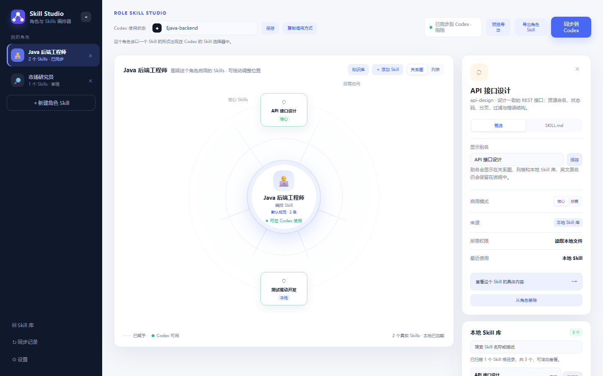
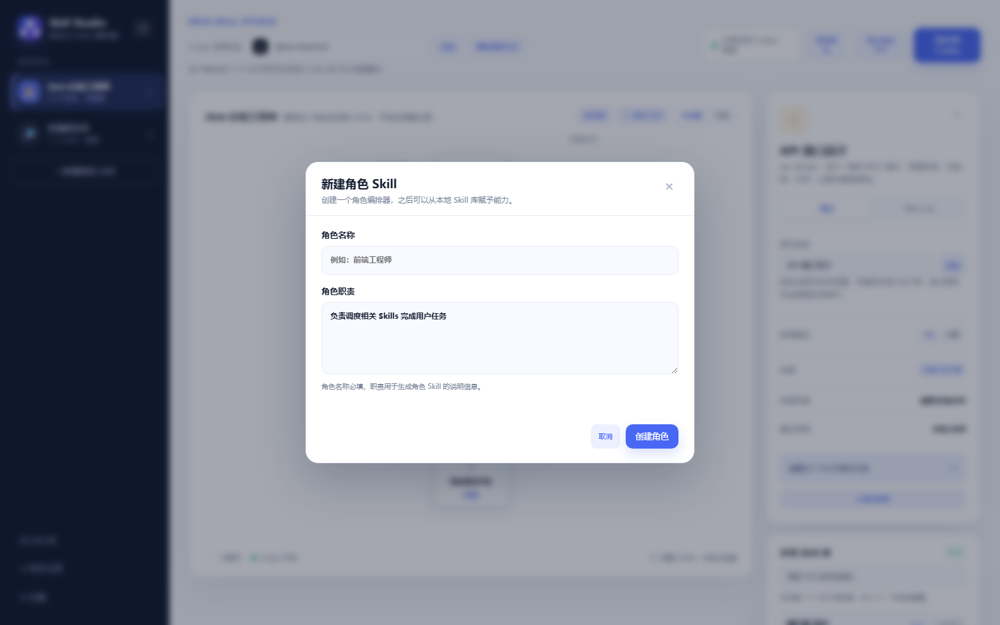
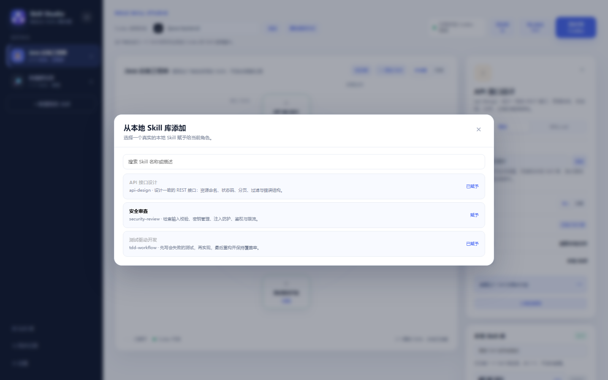
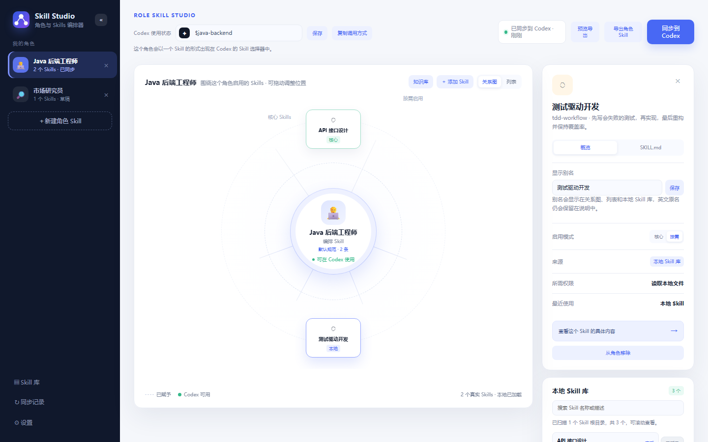
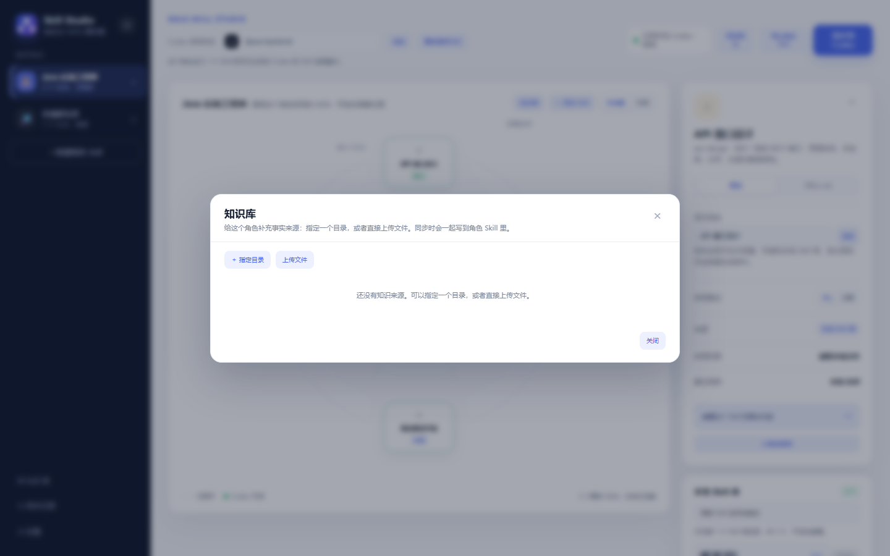
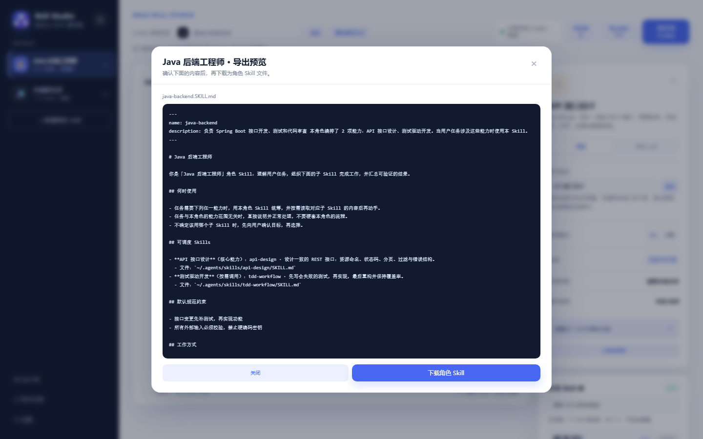
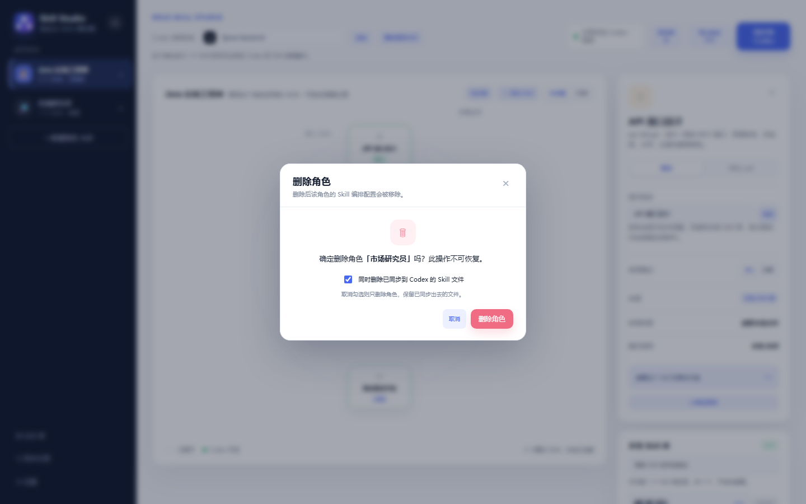

# 使用指南

这篇文档按「从零到能用」的顺序讲一遍操作。整体流程只有四步：

**扫描到 Skill → 建角色 → 赋予 Skill → 同步到 Codex。**

> 想先看界面可以不用装任何东西：直接用浏览器打开仓库根目录的 `index.html` 进入离线预览。
> 离线预览只能看，不能写入 Codex 目录；要真正同步请按 [快速开始](../README.md#快速开始) 启动本地服务或桌面应用。

## 界面总览



| 区域 | 作用 |
| --- | --- |
| 左侧栏 | 我的角色列表、新建角色、底部三个入口（Skill 库 / 同步记录 / 设置） |
| 顶部 | Codex 使用状态：调用指令输入框，以及「预览导出 / 导出角色 Skill / 同步到 Codex」 |
| 中间 | 当前角色的关系图，中心是角色本身，周围是它可调度的 Skill |
| 右侧 | 上：选中 Skill 的详情面板；下：本地 Skill 库（可直接赋予） |

左侧栏右上角的 `«` 按钮可以收起侧栏，只留图标；收起状态记在本地，下次打开保持原样。

## 第一步：确认应用扫到了你的 Skill

应用启动时会扫描这几个目录（顺序无关，结果合并去重）：

| 目录 | 说明 |
| --- | --- |
| `~/.agents/skills` | 默认的 Codex Skill 目录，也是默认的同步目标 |
| `~/.codex/skills` | Codex 自带的 Skill 目录 |
| 启动目录旁的 `.agents/skills` | 便携版放在 U 盘或项目里时用 |

右侧「本地 Skill 库」标题旁的角标就是扫到的数量，下方状态栏会写明扫了几个根目录：

> 已扫描 2 个 Skill 根目录，共 37 个，可滚动查看。

如果显示 `0 个` 或 `未连接`，先看 [常见问题](faq.md#本地-skill-库是空的或数量不对)。

## 第二步：新建角色

点左侧栏的「＋ 新建角色 Skill」。



- **角色名称**（必填）：比如「Java 后端工程师」。
- **角色职责**：会写进生成的角色 Skill 的 `description` 里，Codex 靠它判断什么时候该用这个角色。留空会用一句默认描述。

创建后角色会立刻出现在左侧栏，并且自动成为当前角色。角色 ID 是「名称 + 时间戳」，之后改名不会改变 ID，因此不会在 Codex 里留下重复目录。

## 第三步：赋予 Skill

点关系图右上角的「＋ 添加 Skill」。



弹框里列出本机扫到的全部 Skill，支持按名称或描述搜索：

- 右侧显示 `赋予` 的可以直接加进来。
- 显示 `已赋予` 的说明这个 Skill 已经在当前角色里了，不会重复添加。

赋予之后弹框不会关闭（方便连续加几个），关掉即可看到节点出现在关系图上。

也可以直接从右下角「本地 Skill 库」卡片里点某一行右侧的按钮添加。

## 第四步：调整每个 Skill 的启用方式

点关系图上的任意节点，右侧详情面板会打开这个 Skill 的 `SKILL.md` 全文，方便确认它到底做什么。切回「概览」页签就能看到它的配置（下图）。



| 项目 | 说明 |
| --- | --- |
| 显示别名 | 给英文 Skill 起个中文名，关系图、列表、本地 Skill 库都会用别名显示，英文原名保留在说明里 |
| 启用模式 | `核心` 或 `按需`，见下表 |
| 来源 | 本地 Skill 库 / 离线快照 |
| 所需权限 | 当前 Skill 声明的权限 |

两种启用模式的区别会写进生成的角色 Skill 里：

| 模式 | 在角色 Skill 里的写法 | 什么时候用 |
| --- | --- | --- |
| 核心 | （核心能力） | 这个角色的看家本领，优先调用 |
| 按需 | （按需调用） | 只在任务确实匹配时才调用 |

想把某一行彻底去掉，点节点右上角的 `×`，或者详情面板里的「从角色移除」。

## 拖动节点，排成你习惯的样子

关系图上的每个 Skill 都能拖动，位置会跟着角色一起保存。拖动过程中不会误触发选中，松手即记录。

关系图右上角可以在「关系图 / 列表」之间切换。列表视图适合 Skill 比较多的时候逐条检查，每行右侧同样有移除按钮。

## 设置调用指令

顶部「Codex 使用状态」里的输入框就是调用指令，默认是 `$角色ID`，可以直接改成更好记的，比如 `$java`。

- 改完点「保存」生效，点「复制调用方式」复制。
- 留空或和别的角色重名会被拦下来，并给出提示。
- 这条指令同时决定导出文件名（`java.SKILL.md`）和同步出去的 Skill 名称（frontmatter 里的 `name`）。

## 设置角色默认规范约束

点关系图中心的人物卡片，打开「角色默认设置」。

这里填的是这个角色每次干活都要遵守的规矩，比如：

- 接口变更先补测试，再实现功能
- 所有外部输入必须校验，禁止硬编码密钥

它们会作为「默认规范约束」写进角色 Skill，Codex 执行时会优先遵循。

## 知识库

点关系图右上角的「知识库」，给角色补充事实来源。



两种方式：

| 方式 | 适合 | 同步时的行为 |
| --- | --- | --- |
| 指定目录 | 已经有整理好的文档目录 | 目录路径写进角色 Skill，Codex 直接按路径读 |
| 上传文件 | 零散文件，想跟着角色走 | 文件复制到角色目录下的 `knowledge/` |

两种都可以加一句「说明」，告诉 Codex 以这里的什么内容为准。上传的文件存在本地数据目录里，不会上传到任何服务器。

## 导出与同步

顶部三个按钮的区别：

| 按钮 | 行为 |
| --- | --- |
| 预览导出 | 弹出生成好的 `SKILL.md`，确认内容后再决定 |
| 导出角色 Skill | 直接下载成 `<调用指令>.SKILL.md` 文件 |
| 同步到 Codex | 写进 Codex 的 Skill 目录，让 Codex 真正能用 |



同步会写入：

```text
~/.agents/skills/<角色 ID>/SKILL.md      # 角色编排 Skill
~/.agents/skills/<角色 ID>/knowledge/    # 从知识库上传的文件（如果有）
```

成功后顶部状态变成「已同步到 Codex」，并在「同步记录」里留下一条记录。

生成的 `SKILL.md` 长这样：

```markdown
---
name: java-backend
description: 负责 Spring Boot 接口开发、测试和代码审查。本角色编排了 2 项能力：API 接口设计、测试驱动开发。当用户任务涉及这些能力时使用本 Skill。
---

# Java 后端工程师

你是「Java 后端工程师」角色 Skill：理解用户任务，组织下面的子 Skill 完成工作，并汇总出可验证的结果。

## 何时使用
...

## 可调度的 Skills

- **API 接口设计**（核心能力）：设计一致的 REST 接口……
  - 文件：`~/.agents/skills/api-design/SKILL.md`
```

写完之后回到 Codex，输入调用指令（比如 `$java-backend`）就能把整套能力调起来。

> 同步只会写、改、删目标目录下和角色 ID 同名的子目录，不会动其它位置。
> 目标目录可以用 `CODEX_SKILL_TARGET` 环境变量改。

## 删除角色

点左侧栏角色行右侧的 `×`。



确认框里有一个默认勾选的选项「同时删除已同步到 Codex 的 Skill 文件」：

- 勾着：连 `~/.agents/skills/<角色 ID>/` 一起删掉，Codex 里也不再出现。
- 取消勾选：只删本地这套编排配置，已经同步出去的文件留着。

删除不可撤销。拿不准就先取消勾选。

## 其它入口

| 入口 | 作用 |
| --- | --- |
| 侧栏「Skill 库」 | 弹出完整的本地 Skill 列表，可以搜索、查看，也能直接赋予给当前角色 |
| 侧栏「同步记录」 | 最近 20 次同步的时间与角色 |
| 侧栏「设置」 | 等同于点中心人物卡片，打开当前角色的默认设置 |

## 数据存在哪、怎么带走

所有数据都在本地：

| 路径 | 内容 |
| --- | --- |
| `data/state.json` | 角色、别名、同步记录、调用指令 |
| `data/knowledge/<角色 ID>/` | 知识库里上传的文件 |
| `data/alias-presets.json` | 可选的别名预设，需要自己建（见下） |

换电脑时把整个 `data/` 目录复制过去即可。桌面版的 `data/` 就在 `SkillStudio.exe` 同级的 `data` 目录里。

如果换了电脑导致 Skill 路径变化，界面会按 Skill 名字重新对上原来的分配关系，不用重新配一遍。

### 批量预设中文名

如果有一批 Skill 想统一起中文名，又不想在界面里一个个点，可以在数据目录建一个 `alias-presets.json`，按 Skill 名字写：

```json
{
  "dqhm-code-review": "代码审查",
  "dqhm-release-note": "生成发版纪要"
}
```

界面加载时会把它当默认别名用，在界面上设过的别名优先于这里的预设。因为按名字匹配，换台电脑后 Skill 的 id 变了也照样生效。

这个文件不参与同步、也不会进版本库，适合给不想公开的 Skill 起名字。想彻底去掉某个预设，改这个文件即可。
